<!-- ============ BANNER ============ -->

  

<!-- ============ TYPING INTRO ============ -->

  

  
  

---

## 👨‍💻 About Me

- 🌱 Currently learning **Next.js** and diving deeper into the React ecosystem
- 💻 Full-stack developer who enjoys turning ideas into clean, responsive web apps
- 🧩 Regular problem solver on **LeetCode** — sharpening my DSA skills with C++
- 🎨 I care about good UI/UX and love prototyping in **Figma**
- 📫 Reach me at **[shahinrayhan92@gmail.com](mailto:shahinrayhan92@gmail.com)**

---

## 🛠️ Languages & Tools

  

| Area | Tech |
| :-- | :-- |
| **Languages** | C++, JavaScript, TypeScript |
| **Frontend** | React, Next.js, HTML5, CSS3, Tailwind CSS |
| **Tools** | Git, GitHub, Postman, Figma |

---

## 📊 GitHub Stats

<!-- 

  
  

 -->

  

---

## 🚀 Featured Projects

<!-- Replace the placeholders below with your real projects -->

| Project | Description | Tech |
| :-- | :-- | :-- |
| [**Project One**](https://github.com/armaannii/project-one) | Short description of what it does and why it's cool | `Next.js` `TypeScript` `Tailwind` |
| [**Project Two**](https://github.com/armaannii/project-two) | Short description of what it does and why it's cool | `React` `JavaScript` |
| [**Project Three**](https://github.com/armaannii/project-three) | Short description of what it does and why it's cool | `C++` |

---

## 🎯 Currently Working On

- [x] Building a strong foundation in React
- [ ] Mastering **Next.js** (App Router, Server Components, API routes)
- [ ] Improving TypeScript skills
- [ ] Solving more LeetCode problems consistently

---

## 🤝 Let's Connect

  
  
  
  

  <i>"First, solve the problem. Then, write the code."</i> ⚡

